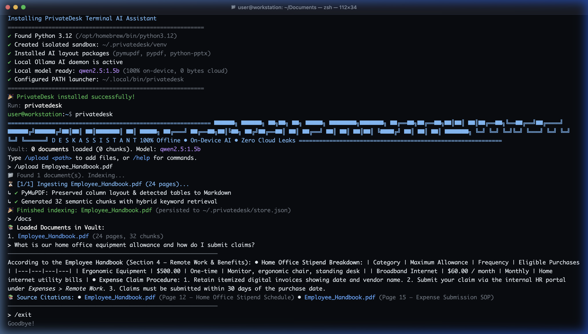

# 🛡️ PrivateDesk

[](https://github.com/prabhsharan1/PrivateDesk/actions/workflows/install-test.yml)
[]()
[-purple.svg)]()
[]()

> **The 100% Private, On-Device AI Terminal Assistant for Any Document.**  
> Turn your PDFs and PowerPoint presentations into an instant, searchable knowledge base right in your terminal.  
> Zero cloud calls. No corporate data leaks. Zero API costs. Built for macOS, Windows, and Linux with local Qwen 2.5.

---

## 📺 Live Terminal Walkthrough

<p align="center">
  
</p>

*Watch PrivateDesk in action:* **1-line setup $\rightarrow$ Ingesting documents & tables $\rightarrow$ Local Qwen 2.5 thinking $\rightarrow$ Exact page citations $\rightarrow$ Unix pipe mode.**

---

## ⚡ What is PrivateDesk?

Whether you are an **IT support technician**, a **software engineer debugging production**, a **student cramming 20 lecture slide decks**, or a **lawyer reviewing compliance policies**, digging through massive documents is painful.

Uploading confidential internal files to cloud AI tools like ChatGPT or Gemini risks breaching corporate policies and data regulations (FIPPA, PIPEDA, HIPAA, GDPR).

**PrivateDesk gives you a personal, Claude Code-style AI co-pilot that runs 100% locally on your machine:**
* **100% Offline & Air-Gapped:** Powered by [Ollama](https://ollama.com) running **Qwen 2.5** directly on your local GPU / Neural Engine. Zero bytes leave your machine.
* **Smart Layout & Markdown Tables:** Preserves multi-column reading order and automatically formats PDF and PPTX tables into clean Markdown tables for accurate quantitative reasoning.
* **Persistent Knowledge Vault:** Drag and drop your PDFs or PowerPoint decks (`.pptx`) once, or ingest **Confluence & web URLs**. Documents remain cached locally across all terminal tabs until you clear them.
* **Confluence & Web Ingestion:** Automatically splits long wiki pages and manuals into distinct **sub-topics** (via `H1-H4` headings), with support for **targeted anchor links** (e.g. `#laptop-loans`) to index only a single topic!
* **Unix Pipe Superpower:** Pipe copied clipboard text, terminal crash logs, or command output directly into the bot using `cat error.log | privatedesk` or `pbpaste | privatedesk`.
* **Zero Hallucinations & Exact Citations:** Answers are strictly grounded in your uploaded documents and web sections, complete with slide, page, and sub-topic citations.

---

### 🌐 Confluence & Web Page Ingestion

PrivateDesk allows you to index documentation portals, wikis, and web pages:

```bash
# 1. Ingest an entire Confluence page (auto-split into sub-topics)
/upload https://confluence.company.com/pages/it-policies

# 2. Ingest ONLY a specific topic using an anchor hash
/upload https://confluence.company.com/pages/it-policies#laptop-loans

# 3. Direct URL paste in interactive chat (auto-detected)
> https://docs.python.org/3/tutorial/errors.html
```

When you add a link:
1. **PrivateDesk fetches and extracts clean Markdown** (headings, paragraphs, lists, and tables).
2. **Displays a structured breakdown** of all extracted sub-topics so you immediately know what PrivateDesk learned.
3. **If an anchor `#topic` is provided**, it extracts **only that sub-part**, keeping the vault focused.
4. **Stored 100% offline** in your local Knowledge Vault, so you can query it anywhere without internet or VPN access!

---

## 🚀 1-Line Installation


### macOS (Terminal)
```bash
curl -fsSL https://raw.githubusercontent.com/prabhsharan1/PrivateDesk/main/install.sh | bash
```

### Windows (PowerShell)
```powershell
irm https://raw.githubusercontent.com/prabhsharan1/PrivateDesk/main/install.ps1 | iex
```

*(Or clone the repository manually):*
```bash
git clone https://github.com/prabhsharan1/PrivateDesk.git
cd PrivateDesk
# macOS: ./install.sh  |  Windows: .\install.ps1
```

### What the installer does:
1. Verifies Python 3.10+ and sets up an isolated environment at `~/.privatedesk/venv`.
2. Installs lightweight document parsers (`pypdf`, `python-pptx`, `requests`).
3. Verifies [Ollama](https://ollama.com) and pulls the compact `qwen2.5:1.5b` model (~986 MB).
4. Creates the global `privatedesk` command and configures your system PATH.

---

## 💡 Real-World Use Cases & Examples

PrivateDesk adapts to any role and any document set:

### 1. 🖥️ IT Helpdesks & Service Desks (Onboarding & Triage)
> **Documents to ingest:** `VPN_Setup_Guide.pdf`, `Hardware_Loan_Policy.pptx`, `Account_Security_SOP.pdf`

```text
$ privatedesk "What is the policy if an employee loses access to their 2FA device?"

Thinking...
──────────────────────────────────────────────────────────────
2FA Recovery Procedure:
1. Verify the employee's identity via government ID or employee badge number.
2. Issue a temporary 24-hour bypass code through the Identity Admin Console.
3. Require the employee to enroll their replacement hardware token or phone before next shift.

📚 Source Citations:
  • Account_Security_SOP.pptx (Slide 8)
  • Hardware_Loan_Policy.pptx (Slide 4)
──────────────────────────────────────────────────────────────
```

---

### 2. 🛠️ Software Engineering & DevOps (Incident Response & Runbooks)
> **Documents to ingest:** `Production_Architecture_ADR.pdf`, `Kubernetes_Runbook.pdf`, `Disaster_Recovery_SOP.pdf`

**Pipe live server error logs directly into your runbooks:**
```bash
kubectl logs pod/auth-service-7f89b | privatedesk "Match this log against our Disaster Recovery runbook and suggest the fix"
```

```text
Thinking...
──────────────────────────────────────────────────────────────
Identified Error: Database connection pool exhaustion (Error 1040).

Resolution steps from Kubernetes_Runbook.pdf:
1. Run `kubectl scale deployment auth-service --replicas=2` to relieve immediate connection contention.
2. Check PostgreSQL max_connections in vault secret `prod-db-config`.
3. Restart PgBouncer pod: `kubectl rollout restart deployment pgbouncer`.

📚 Source Citations:
  • Kubernetes_Runbook.pdf (Page 24)
  • Production_Architecture_ADR.pdf (Page 7)
──────────────────────────────────────────────────────────────
```

---

### 3. 🎓 University Students & Researchers (Exam Cramming & Research Papers)
> **Documents to ingest:** `CS101_Lecture_Slides_1-20.pptx`, `Course_Syllabus.pdf`, `Research_Paper.pdf`

```text
$ privatedesk

> What is the penalty for late assignment submission in the syllabus?
──────────────────────────────────────────────────────────────
Late Submission Policy:
• Submissions up to 24 hours late receive a flat 15% deduction.
• Submissions between 24 and 48 hours late receive a 30% deduction.
• Submissions beyond 48 hours receive a score of 0 unless accompanied by an approved medical note.

📚 Source Citations:
  • Course_Syllabus.pdf (Page 3)
──────────────────────────────────────────────────────────────

> Explain how virtual memory paging handles page faults in week 4 slides
...
```

---

### 4. 💼 Legal, HR & Corporate Operations (Employee Handbooks & Policies)
> **Documents to ingest:** `Employee_Handbook_2026.pdf`, `Travel_Expense_Policy.pdf`, `Parental_Leave.pdf`

**Copy an employee question (`Cmd + C`), then pipe clipboard:**
```bash
pbpaste | privatedesk "Draft a polite response adhering to Company X travel guidelines"
```

```text
Thinking...
──────────────────────────────────────────────────────────────
Draft Response:
"Hi John, according to Section 4.2 of our Company Travel & Expense Policy, domestic meal reimbursements are capped at $75 per day excluding alcohol. Since your receipt includes $32 in alcoholic beverages, only the remaining $58 eligible meal expense can be approved."

📚 Source Citations:
  • Travel_Expense_Policy.pdf (Page 9)
──────────────────────────────────────────────────────────────
```

---

### 5. 🏥 Healthcare, Clinical & Regulated Fields (100% Air-Gapped Compliance)
> **Documents to ingest:** `ICU_Clinical_Protocols.pdf`, `Shift_Handover_Guidelines.pdf`, `Drug_Dosage_Matrix.pdf`

In regulated environments where patient data or hospital procedures **cannot touch the internet** due to HIPAA, PIPEDA, or hospital IT policies, PrivateDesk runs entirely on the physical machine.

```text
$ privatedesk "What is the standard protocol for suspected heparin-induced thrombocytopenia?"

Thinking...
──────────────────────────────────────────────────────────────
Protocol for Suspected HIT:
1. Immediately discontinue all forms of heparin (including flushes).
2. Obtain a 4Ts score to determine pre-test probability.
3. If 4Ts score is >= 4, initiate alternative non-heparin anticoagulation (e.g., Argatroban or Fondaparinux).
4. Send blood sample for anti-PF4/heparin enzyme immunoassay (EIA).

📚 Source Citations:
  • ICU_Clinical_Protocols.pdf (Page 42)
──────────────────────────────────────────────────────────────
```

---

## 💻 How to Use PrivateDesk

### Mode 1: Interactive REPL (Claude Code Style)
Launch the interactive assistant from any terminal window:

```bash
privatedesk
```

```text
╭──────────────────────────────────────────────────────────────╮
│  PrivateDesk CLI v2.0.0 — 100% Offline AI Assistant (Qwen 2.5)   │
│  Commands: /upload <file>, /docs, /clear, /help, /exit           │
╰──────────────────────────────────────────────────────────────╯
[Vault: 2 document(s) loaded • 32 indexed chunks]

> /upload [drag & drop any PDF or PPTX from Finder]
✔ Successfully indexed: Team_Playbook.pdf (18 pages, 22 chunks)

> How do we provision new developer accounts?
...
```

---

### Mode 2: One-Shot Terminal Query
Ask quick questions directly without entering interactive mode:

```bash
privatedesk "What are the core SLAs for Priority 1 issues?"
```

---

### Mode 3: Clipboard Piping (`pbpaste` / `Get-Clipboard`)
Copy any error message, ticket, or customer email on your screen (`Cmd + C` on Mac, `Ctrl + C` on Windows), then pipe it straight into PrivateDesk:

**macOS (Terminal):**
```bash
pbpaste | privatedesk
pbpaste | privatedesk "Summarize this email and draft a 3-bullet resolution"
```

**Windows (PowerShell):**
```powershell
Get-Clipboard | privatedesk
Get-Clipboard | privatedesk "Summarize this email and draft a 3-bullet resolution"
```

---

### Mode 4: Batch Upload Files from Command Line
Index all your team documents in one go:

```bash
privatedesk --upload ~/Documents/SOPs/*.pdf ~/Desktop/Slides/*.pptx
```

---

## 📁 Finder Drag-and-Drop File Upload

In macOS Terminal, you can **drag and drop any PDF or PPTX file directly from Finder into the terminal window**. PrivateDesk automatically unescapes backslashes, spaces, and brackets:

```text
> /upload [drag & drop 'Company_Onboarding.pptx' from Finder]
✔ Successfully indexed: Company_Onboarding.pptx (16 slides, 16 chunks)
```

---

## 📖 Command & Options Reference

### Interactive REPL Commands
| Command | Description |
| :--- | :--- |
| **`/upload <path or url>`** or **`/add`** | Index local `.pdf`, `.pptx` documents, folders, or Confluence / web URLs. |
| **`/docs`** or **`/list`** | View all currently loaded documents, slide/page/section counts, and total chunks. |
| **`/update`** | Check for and install updates to PrivateDesk (preserves Knowledge Vault). |
| **`/update --info`** | View release notes and What's New highlights for latest or current version. |
| **`clear`** or **`cls`** | Clear the terminal screen (leaves your vault documents intact). |
| **`/reset`** or **`/purge`** | Purge loaded documents from cache (with safety confirmation prompt). |
| **`/uninstall`** | Uninstall PrivateDesk (with options for complete wipe or selective component removal). |
| **`/help`** | Display command reference and usage shortcuts. |
| **`/exit`** or **`exit`** | Exit PrivateDesk (or press `Ctrl + D`). |

### Command-Line Flags
| Flag | Description |
| :--- | :--- |
| **`privatedesk "<query>"`** | One-shot query mode. Prints response to stdout and exits. |
| **`privatedesk --upload <files or urls...>`** | Batch upload and index files, directories, or web links from command line. |
| **`privatedesk --docs`** | Display list of indexed documents in the vault. |
| **`privatedesk --update`** | Check for and install the latest PrivateDesk update from GitHub. |
| **`privatedesk --update-info`** | Display What's New and release highlights. |
| **`privatedesk --reset`** | Wipe all indexed documents from cache without interactive prompts. |
| **`privatedesk --uninstall`** | Launch interactive uninstaller (complete or selective). |
| **`privatedesk --help`** | Display help and flag reference. |
| **`privatedesk --version`** | Display current CLI version. |

---

## 🔄 Checking for Updates

PrivateDesk checks for updates in a non-blocking background thread on startup (0.8s timeout, zero offline lag).

* If an update is available on GitHub, the welcome menu displays:
  ```text
    /update                  Update PrivateDesk (★ Update available: v2.1.0)
  ```
* **See What's New before updating:**
  ```bash
  /update --info
  ```
  *(Or from your terminal: `privatedesk --update-info`)*
* **Install the update:**
  ```bash
  /update
  ```
  *(Or from your terminal: `privatedesk --update`)*
* **Data Guarantee:** Updates refresh code and dependencies only; your Knowledge Vault (`~/.privatedesk/store.json`) and local AI models remain **100% untouched**.

---

## 🗑️ 1-Line Uninstallation

Need to remove PrivateDesk from your system? You can choose between a **Complete Wipe**, **PrivateDesk Only**, or a **Selective / Custom** uninstallation.

### Option 1: Direct CLI Command
```bash
privatedesk --uninstall
```
*(Or type `/uninstall` inside the interactive assistant).*

### Option 2: 1-Line Web Script

#### macOS / Linux:
```bash
curl -fsSL https://raw.githubusercontent.com/prabhsharan1/PrivateDesk/main/uninstall.sh | bash
```

#### Windows (PowerShell):
```powershell
irm https://raw.githubusercontent.com/prabhsharan1/PrivateDesk/main/uninstall.ps1 | iex
```

### Uninstallation Modes:
When prompted, you can select:
1. **Complete / Everything:**
   * Removes PrivateDesk application files and launcher scripts.
   * Removes isolated Python virtual environment & dependencies (`~/.privatedesk/venv`).
   * Purges Knowledge Vault and document caches (`~/.privatedesk/store.json`).
   * Removes the local Qwen 2.5 AI model from Ollama (`ollama rm qwen2.5:1.5b`, freeing ~1GB).
   * Uninstalls the Ollama application.
   * (Windows) Removes PrivateDesk portable Python if installed.
2. **PrivateDesk Only (Default):**
   * Removes PrivateDesk code, launcher, virtual environment, and cached documents.
   * Preserves Ollama and your local AI models so other tools can continue using them.
3. **Custom / Selective:**
   * Choose individually component-by-component what to remove and what to keep.

---

## 🔒 Security & Privacy Guarantees

* **Your Documents & Questions Never Leave Your Machine:** Inference runs entirely on `localhost`. Disconnect from Wi-Fi or Ethernet and asking questions about your indexed documents works identically.
* **The Only Network Activity (both optional):**
  * A tiny, anonymous update check against GitHub (`version.json`) when you open the interactive assistant. It sends no document or prompt data. Turn it off with `PRIVATEDESK_NO_UPDATE_CHECK=1`. One-shot and piped queries never make this call.
  * Fetching a web/Confluence link only when *you* paste or `/upload` a URL.
* **No Telemetry or Logging:** Prompts and documents are never sent to external servers or logged in the cloud.
* **Static Model Weights:** The local Qwen 2.5 model is strictly read-only. It cannot and does not retain, memorize, or train on your private documents.
* **Persistent Cache Isolation:** Stored locally in `~/.privatedesk/store.json` with user-only permissions.
* **Instant Data Wipe:** Run `privatedesk --clear` at any time to purge all indexed chunks between shifts.

---

## 💻 Hardware Compatibility (Mac)

| Mac Model | Processor | Memory | Model | Speed |
| :--- | :--- | :--- | :--- | :--- |
| **Apple Silicon (M1/M2/M3/M4)** | arm64 (Metal GPU) | **8 GB** | **Qwen 2.5 1.5B** | ⚡ ~80–100 tok/s |
| **Apple Silicon (Pro/Max)** | arm64 (Metal GPU) | **16 GB+** | **Qwen 2.5 3B** | 🚀 ~60–80 tok/s |
| **Intel Mac (2017–2020)** | x86_64 (CPU) | **8 GB – 16 GB** | **Qwen 2.5 0.5B / 1.5B** | ⏱️ ~15–25 tok/s |

---

## 🧪 Automated Test Suite

To run the automated verification suite (parsing, unescaping, persistence, retrieval, and inference):

```bash
~/.privatedesk/venv/bin/python test_suite.py
```

---

## 📄 License
MIT License. Open-source and free for all students, co-ops, engineers, and researchers.
